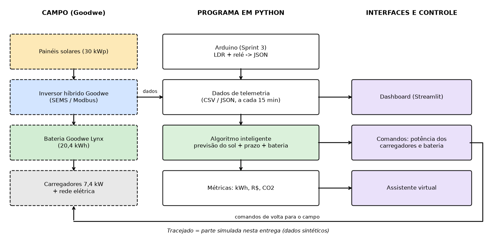
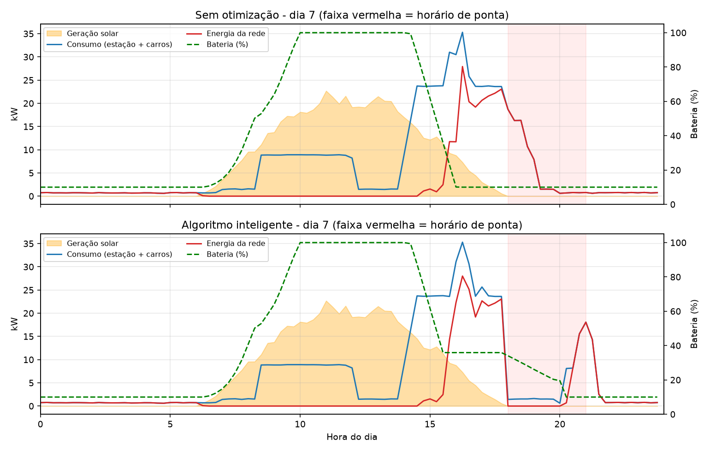
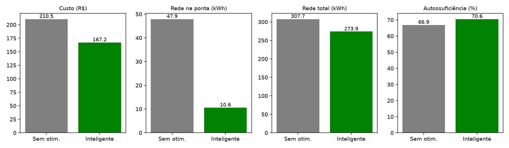
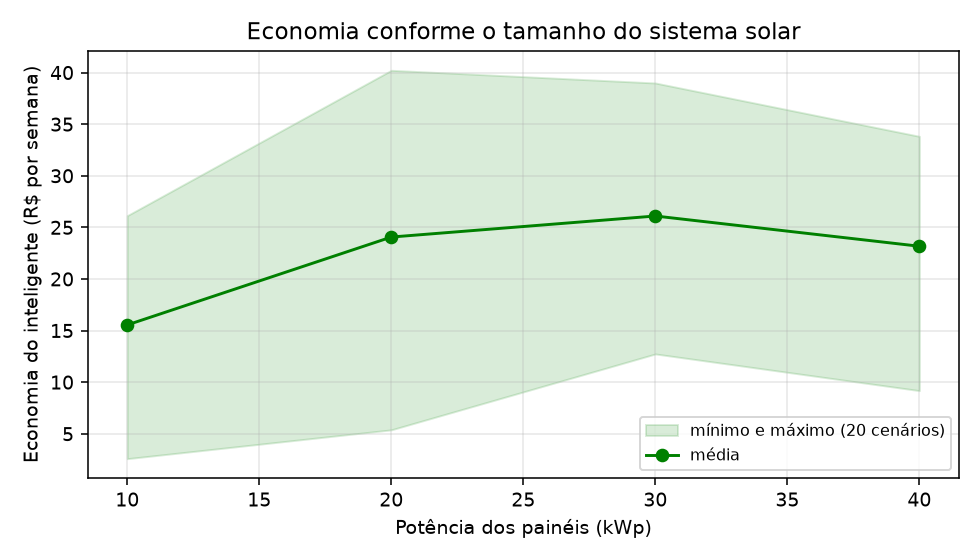

# ChargeGrid - Estação de recarga solar inteligente (Goodwe)

Sprint 4 - Solução final integrada

- **Equipe:**
- Carlos Eduardo Affonso — RM 569676
- Gabriel Oliveira Gusmão Florêncio dos Santos — RM 573747
- Gustavo de Souza Abreu — RM 574080
- Gabrieli de Lima Pettena de Oliveira — RM 569799
- Igor Massone Monteiro — RM 573853
- Temitope Kuku da Silva Ogunbanjo — RM 573772  
- **Vídeo:** _(colar o link)_

## 1. O que é o projeto

O ChargeGrid é uma estação de recarga de carros elétricos alimentada por painéis solares e uma bateria.
Na Sprint 3 fizemos a parte de borda: um Arduino com sensor de luz (LDR) e relé que só liberava a recarga
quando a luminosidade passava de 20%.

Na Sprint 4 pegamos essa ideia e montamos o sistema completo em Python: uma simulação de painéis + bateria +
rede + carros (nos moldes de um sistema híbrido Goodwe), um algoritmo que decide quando carregar cada carro,
um dashboard e um assistente virtual que responde perguntas sobre a estação.

Importante: **todos os dados são simulados** (gerados em `simulacao.py`). Não testamos com um inversor Goodwe real.

## 2. Arquitetura



- **Campo (Goodwe):** painéis solares, inversor híbrido, bateria Lynx e carregadores. Nesta entrega essa parte é simulada.
- **Arduino (Sprint 3):** lê o LDR e imprime um JSON. O `ponte_arduino.py` lê esse JSON e decide liberar ou adiar a recarga.
- **Programa em Python:** gera os dados a cada 15 minutos, roda o algoritmo, calcula as métricas e guarda tudo em CSV/JSON.
- **Interfaces:** dashboard em Streamlit e o assistente virtual.

Arquivos principais:

| Arquivo | O que faz |
|---|---|
| `parametros.py` | valores do sistema (kWp dos painéis, bateria, tarifas...) |
| `simulacao.py` | gera o cenário, tem o algoritmo inteligente e faz o balanço de energia |
| `metricas.py` | calcula custo, autossuficiência, CO2 |
| `assistente.py` | assistente virtual (responde por palavras-chave) |
| `graficos.py` | gráficos e diagrama da arquitetura |
| `main.py` | roda tudo e salva em `results/` e `docs/img/` |
| `dashboard.py` | dashboard Streamlit |
| `ponte_arduino.py` | liga o Arduino da Sprint 3 ao programa |
| `testes.py` | testes simples (balanço de energia, limites da bateria, atendimento) |

## 3. Como o algoritmo funciona

Comparamos dois jeitos de controlar a estação:

**Sem otimização:** o carro começa a carregar assim que chega, na potência máxima. A bateria só cobre falta de energia.

**Inteligente:** a cada 15 minutos, para cada carro:
1. Se está quase sem tempo para terminar a carga (folga de 30 min ou menos), carrega na potência máxima. Isso garante que ninguém sai sem a energia pedida.
2. Se tem folga, carrega só com a sobra dos painéis (geração menos o consumo da estação). Quem sai primeiro tem prioridade.
3. Se a previsão de sol até a saída não for suficiente, antecipa a carga pela rede, mas nunca no horário de ponta (18h às 21h). A previsão é simples: 60% do que seria um dia de céu limpo.
4. A bateria é usada livremente na ponta. Fora da ponta só descarrega o que passar de 45% (reserva para a ponta); de madrugada pode esvaziar, porque o sol do dia seguinte recarrega.

## 4. Alinhamento com o desafio Goodwe e com a disciplina

| Ponto do desafio | Como respondemos |
|---|---|
| Geração, armazenamento e uso de energia renovável | balanço completo entre painéis, bateria (com perdas), rede e carros |
| Tecnologias compatíveis com a Goodwe | dimensionamos para um inversor híbrido e baterias Lynx. Para ligar num sistema real, a leitura viria do SEMS Portal ou do próprio inversor (Modbus/UDP, por exemplo com a biblioteca Python `goodwe`). Isso **não foi testado**; precisa conferir o modelo e o protocolo na documentação da Goodwe |
| Monitoramento inteligente | telemetria a cada 15 min, métricas e dashboard |
| Algoritmos inteligentes e automação | algoritmo com prazo de cada carro, previsão de sol e reserva da bateria |
| Interface e visualização | dashboard com sliders e gráficos |
| Assistente virtual | `assistente.py` responde perguntas em português (é um assistente simples, por palavras-chave; não é voz nem IA generativa) |
| Sustentabilidade | uso direto do sol, redução do consumo na ponta e CO2 evitado |

Conteúdos da disciplina que usamos no código: funções, listas e dicionários, laços e condicionais, leitura e escrita
de arquivos (CSV e JSON), bibliotecas (pandas, matplotlib, streamlit) e testes com `assert`.

## 5. Resultados

Cenário base: 7 dias, painéis de 30 kWp, bateria de 20,4 kWh, 4 a 7 carros por dia (rodar `python main.py`).




| Indicador | Sem otimização | Inteligente |
|---|---:|---:|
| Geração solar (kWh) | 768,4 | 768,4 |
| Energia entregue aos carros (kWh) | 740,1 | 740,1 |
| Carros atendidos (%) | 100 | 100 |
| Energia da rede (kWh) | 307,7 | 273,9 |
| Energia da rede na ponta (kWh) | 47,9 | 10,6 |
| Custo da semana (R$) | 210,47 | 167,20 |
| Autoconsumo solar (%) | 82,3 | 86,3 |
| Autossuficiência (%) | 66,9 | 70,6 |
| Pico de potência da rede (kW) | 27,9 | 28,0 |

Ou seja: custo cerca de 21% menor e 78% menos energia da rede na ponta, sem deixar nenhum carro sem carga.

**Teste com 20 cenários diferentes (sementes 0 a 19):** a economia média foi de 18,5% (mínima de 7,7%), e a redução média
da energia na ponta foi de 73,3%. A economia máxima em porcentagem chegou a 63,5%, mas isso acontece em semanas muito
ensolaradas em que o custo base já é baixo, então a porcentagem engana: em reais, o maior ganho em uma semana foi de R$ 39, contra uma média de R$ 26.

**Teste com tamanhos diferentes de painéis (20 cenários para cada):**

| kWp | Custo sem otimização (R$/semana) | Economia média (R$/semana) |
|---:|---:|---:|
| 10 | 534,7 | 15,5 |
| 20 | 344,3 | 24,1 |
| 30 | 173,3 | 26,1 |
| 40 | 22,6 | 23,2 |



**Carbono:**
- A energia solar usada na própria estação (cerca de 663 kWh na semana) evita aproximadamente 26 kg de CO2 em relação à rede. É pouco, porque a rede brasileira já é bem limpa.
- O ganho maior vem de trocar combustão por elétrico: as recargas da semana equivalem a 4.441 km e evitam cerca de 833 kg de CO2.

## 6. Avaliação crítica

O que funcionou: o ganho financeiro e a redução do consumo na ponta foram consistentes nos testes, e o autoconsumo
solar melhorou um pouco.

Limitações:
- O ganho depende do tamanho do sistema solar. Com painéis pequenos (10 kWp) a economia é de só uns 3%, porque não sobra sol para deslocar as recargas.
- Quase todo o ganho é financeiro (tarifa) e de pico. A energia total da rede caiu uns 11%.
- Ainda existe consumo da rede entre 20h e 21h, quando a bateria já acabou.
- A previsão de sol é fixa (60% do céu limpo), não usa dados de clima. A decisão é uma regra simples, não é uma otimização matemática.
- Tarifas e fatores de emissão são exemplos, e os dados são simulados. Sem teste em hardware Goodwe.

Problemas que apareceram no desenvolvimento: a primeira configuração (10 kWp) gerava muito menos que os carros consumiam,
então não tinha o que otimizar, e aumentamos o sistema. Em outra versão, a bateria só descarregava na ponta e ficava cheia de
manhã, o que desperdiçava o sol do meio-dia; por isso criamos a regra da reserva de 45%.

Como melhorias futuras: usar previsão do tempo real, ligar no SEMS Portal ou no inversor, limitar o pico de potência e
trocar o assistente por voz.

## 7. Premissas (todas em `parametros.py`)

Tarifa normal R$ 0,75/kWh, ponta (18h às 21h) R$ 1,60/kWh, crédito de exportação R$ 0,45/kWh (valores de exemplo).
Fator de emissão da rede 0,04 kg CO2/kWh (ordem de grandeza da média brasileira; conferir o valor oficial).
Carro a combustão 0,19 kg CO2/km; carro elétrico 6 km/kWh; carregadores de 7,4 kW (um por carro).

## 8. Como rodar

```
pip install -r requirements.txt
python main.py                      # gera results/ e docs/img/
streamlit run dashboard.py          # dashboard e assistente virtual
python testes.py                    # testes
python ponte_arduino.py --demo      # ponte com o Arduino (sem hardware)
```

## 9. Referências

Python, pandas, matplotlib, Streamlit, pyserial. Arduino e Wokwi (Sprint 3). Documentação da Goodwe (SEMS Portal,
inversores híbridos e baterias Lynx). Biblioteca Python `goodwe`. Fatores de emissão do MCTI para o sistema elétrico brasileiro.
